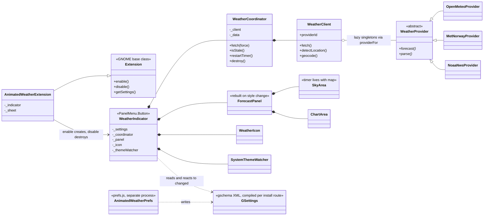
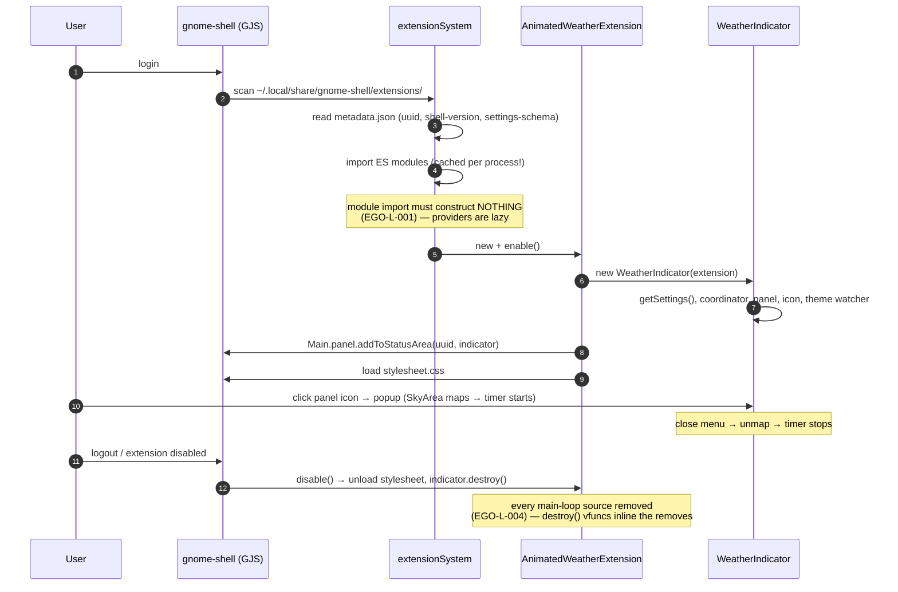
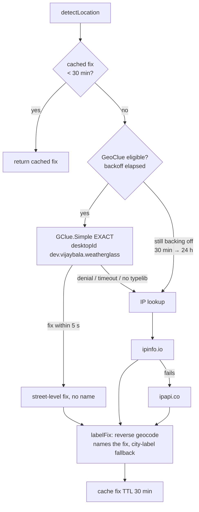

# Developer Onboarding — How Weatherglass Works

The mental model behind the code: how the extension gets loaded and
lives inside the shell, and how weather data flows from three public
APIs into an animated card. Workflow commands live in
[`CONTRIBUTING.md`](../CONTRIBUTING.md); the release ritual lives in
[`skills/weatherglass-release/SKILL.md`](../skills/weatherglass-release/SKILL.md).
This document deliberately owns neither — it owns the *shape*.

## Module map

Everything ships flat at the extension root — GNOME extensions are
plain ES modules loaded into the shell's GJS process.

| File | Responsibility |
|------|----------------|
| `extension.js` | Entry point: the `Extension` subclass, `WeatherIndicator` (the panel button), `WeatherCoordinator` (fetch scheduling), `SystemThemeWatcher` (dark-mode + accent), accent palette |
| `weather.js` | All network I/O: `get()` (the one HTTP helper), three provider adapters, `WeatherClient`, auto-location chain (GeoClue → IP), consent desktop-entry, scene/sun/day-slice pure helpers |
| `menu.js` | `ForecastPanel` (the card), `SkyArea` (animated backdrop), `ChartArea` (morphing hourly chart) |
| `chart.js` | Chart painting, ink referee exports (`pickInk`, `judgeInk`), morph math (`lerp`, `morphPair`, `ease`) |
| `painter.js` | Card/icon surface painting; ground-aware ink decisions |
| `ink-policy.js` | WCAG contrast geometry over sampled glyph boxes (internal math) |
| `sky.js` | Sky backdrop palettes + surface sampling grids |
| `moon.js` | Real lunar-phase geometry (almanac-searched, not fabricated) |
| `animation.js` | `WeatherIcon` — the panel icon, painted per scene |
| `prefs.js` | Preferences window — a separate process (see below) |

### Who holds whom



The lazy-singleton edge is load-bearing: providers are classes at
module scope, instantiated on first use — constructing them at import
time is precisely what EGO-L-001 forbids.

---

## Part 1 — How the extension is loaded

### What "loaded" means

There is no daemon, no subprocess, no IPC for the main surface.
`gnome-shell` runs a GJS (JS + GObject-introspection) runtime; an
extension is ES modules **imported into the shell's own process** and
a class whose `enable()`/`disable()` the shell calls. Every bug class
follows from that: a synchronous disk read in your code stalls *the
whole compositor's UI thread*; a forgotten `timeout_add` source outlives
your objects. These are exactly what the EGO review rules police
(EGO-X-004, EGO-L-001, EGO-L-004 — `BEST-PRACTICES.md` records how each
one bit us).

### Install routes and the schema gotcha

Settings live in a GSettings schema (`schemas/*.gschema.xml`), which
GSettings can only read **compiled**. Who compiles depends on the
install route — and the zip deliberately ships **XML only**
(EGO-P-006):

| Route | Who compiles `gschemas.compiled` |
|-------|--------------------------------|
| extensions.gnome.org website | **EGO compiles server-side** when serving the tree |
| Extensions app (GNOME 45+) | The app, locally, on install |
| `gnome-extensions install` / checkout `./install.sh` | You must — the compile step is in `install.sh` |
| `gnome-shell` at login | **Nobody. The shell never compiles user-extension schemas.** |

Also login-relevant: GNOME 50's shell applies EGO-served extension
*updates* at session start on a pure version comparison — a
verification install raises its **installed** metadata version above
the served one (the release skill, step 4, owns the commands).

### Boot sequence



The GJS module cache is per-process: code changes need a
**logout/login**, which is why the ritual never toggles a running
session (a runtime toggle races `destroy` and can wedge the extension
in `ERROR` until the next login).

### Two processes, two halves

The *surface* (icon, menu, painting) runs inside the shell process.
`prefs.js` runs in a **separate** process (the Extensions app spawns
it) and communicates only through GSettings — which is exactly why
preferences take effect live: `enable()` wires `settings.connect
('changed', …)` and reacts.

---

## Part 2 — How weather data is fetched

### Shape of the pipeline

```mermaid
sequenceDiagram
    autonumber
    participant T as Timer / trigger
    participant C as WeatherCoordinator<br/>(extension.js)
    participant W as WeatherClient<br/>(weather.js)
    participant P as Provider adapter
    participant H as get() · libsoup

    Note over T: refresh-minutes timer · menu open when stale<br/>settings change · provider/model switch · 60 s error retry
    T->>C: fetch(force)
    alt busy
        C->>C: coalesce: refetchPending = true
    else idle
        C->>W: fetch({auto, lat, lon})
        opt auto-location
            W->>W: detectLocation() (cached fix, TTL 30 min)
        end
        W->>P: provider.forecast({latitude, longitude, days, model})
        P->>H: GET url (provider endpoint)
        H-->>P: JSON (200 only; 15 s timeout)
        P->>P: parse() — pure, unit-testable
        P-->>W: normalized {current, daily, hourly}
        W-->>C: + detectedName, latitude, longitude
        C->>C: data, lastFetch
        C-->>C: onData(data) → panel + icon repaint<br/>onError(err) → log + scheduleRetry()
    end
```

Every provider returns **one normalized shape** — the UI never learns
which API answered (the contract is documented above
`WeatherProvider` in `weather.js`):

```js
{
  current: { temp, feels, code /* WMO int */, isDay, humidity,
             precip, wind, windDeg, uv, visibility, cape, intensity, timeIso },
  daily:   [{ date, code, tmax, tmin, precipProb, sunrise, sunset, uv, windMax }],
  hourly:  { time[], temp[], precipProb[], wind[], code[], isDay[] },
}
```

Values come back **canonical metric** (degC, km/h, mm/h); display
converts. Anything unit-testable without a network mock lives in
`parse()` — the fetch half is one `await get()` deep.

### The three providers

| id | Endpoint(s) | Round-trips | Quirks worth knowing |
|----|-------------|------------|----------------------|
| `open-meteo` (default) | `api.open-meteo.com/v1/forecast` | 1 | `om-model` setting passes `models=`; model-specific failure falls back to re-request; also serves the prefs city search (`geocoding-api`) |
| `met-norway` | `api.met.no/weatherapi/locationforecast/2.0/compact` | 1 | **Rejects generic user agents (403)** — `get()`'s UA carries the identification + contact their policy demands |
| `noaa-nws` | `api.weather.gov` | up to 3 | `/points/lat,lon` → `observationStations` → nearest station's `/observations/latest`; NWS text codes → WMO via `nwsTextToWmo()` |

All HTTP goes through the **single** `get()` helper in `weather.js`:
one `Soup.Session` per call, async `send_and_read_async`, 15 s
timeout, 200-or-reject, `JSON.parse`, `session.abort()` in `finally`.
Nothing is ever cached on disk — the privacy claim in the manifest
is a code fact, and `location.test.mjs` / the provider unit tests lock
the parsers against recorded fixtures (no network in tests).

### The auto-location chain

Coordinates, when `auto-location` is on, are *also* a fetch chain —
with honest failure modes because GNOME's consent agent famously does
not prompt for extension-registered clients (that's
[`upstream-report-geoclue.md`](../upstream-report-geoclue.md) Report A):



The consent story ties the two parts together: the desktop entry
(`ensureDesktopEntry`, async read per EGO-X-004) exists so GeoClue's
standard GNOME prompt can *name* the extension when the shell agent
does service it.

### Coordinator timing contract

| Trigger | Timing |
|---------|--------|
| Periodic refresh | `refresh-minutes` setting (`PRIORITY_LOW`) |
| Menu opened | immediate fetch iff `isStale()` (older than the interval) |
| Location (coords) changed | 250 ms debounce |
| Provider / model switch | immediate forced fetch |
| Error | retry in 60 s; GeoClue separately backs off 30 min → 24 h |
| Concurrent `fetch(force)` while busy | coalesced into one trailing fetch |

`WeatherCoordinator` owns **all** its `timeout` sources and removes
them inline in `destroy()` — the pattern the review engine accepts.

---

## Part 3 — The render side in one paragraph

Painting is cairo on `St.DrawingArea` subclasses: `WeatherIcon` for
the panel, `SkyArea` (11 scenes from `sky.js` palettes) behind the
card, `ChartArea` for the hourly morph. The ink referee (`chart.js` +
`ink-policy.js`) samples the painted ground and picks ink by measured
WCAG contrast — day-family glyphs on bright grounds, glow family on
mid/dark — which is what the golden lock byte-canonicalizes. Animation
timers live only while their actor is mapped (menu open): the source
is born in `vfunc_map`, removed in `vfunc_unmap`, with an inline
belt-and-braces remove in `vfunc_destroy`.

## Part 4 — Where truth lives

- **Unit locks** — `tests/*.test.mjs` under `gjs -m` (parsers,
  geometry, ink policy, guide/file-role locks incl. the description
  mirror and command-placement rules).
- **Pixel truth** — the scenario matrix is graded by contrast per
  promise; the **golden lock** byte-diffs 51 blessed renders; changing
  a golden is a bless ceremony requiring **operator approval** (the
  EGO screenshots *are* the goldens).
- **Package truth** — `zipcheck` boots the real zip in a nested
  shell; **`shexli`** — the EGO reviewer's own engine — runs as a
  certify stage. `CERTIFIED` means all of it stood up.
- **Motion truth** — `tools/film.sh` casts the demo video from the
  same nested-shell widgets (the video *is* generated, not recorded).

Read `BEST-PRACTICES.md` before your first PR — it is the distilled
review corpus, corrected the same day any claim in it turns out to be
wrong (see its git history for the honesty receipts).
